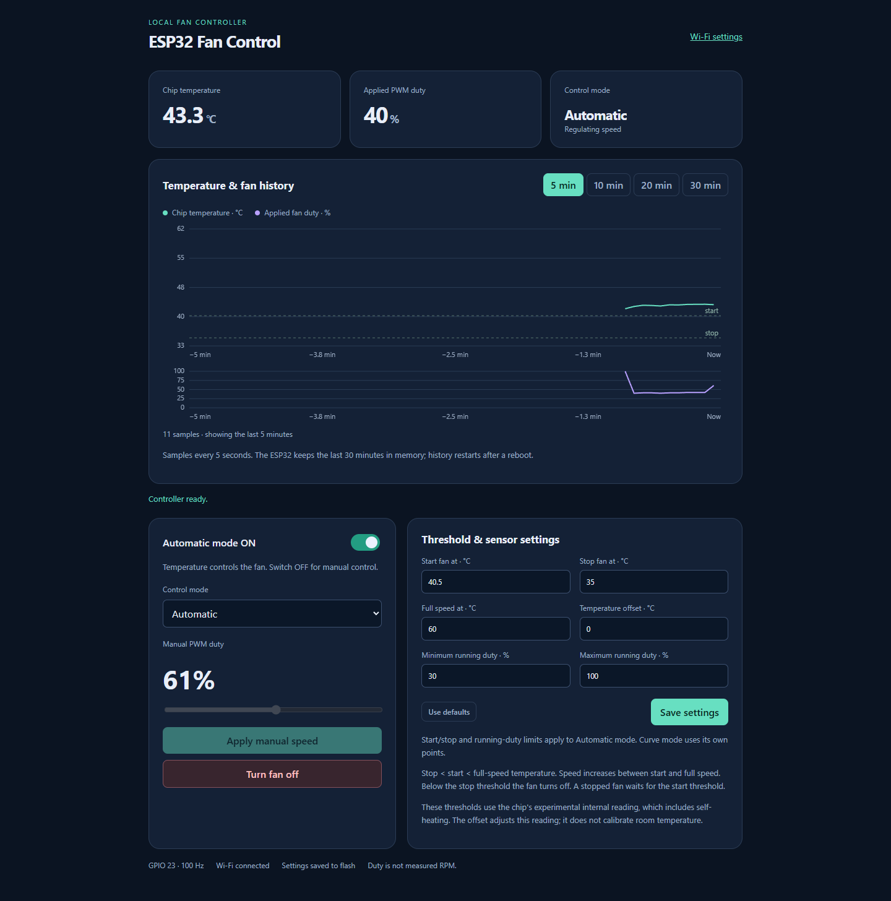
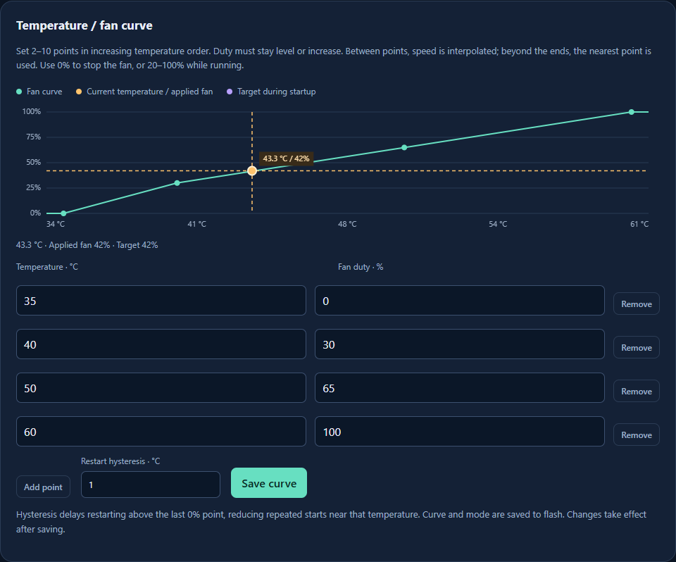
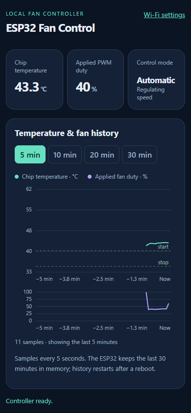
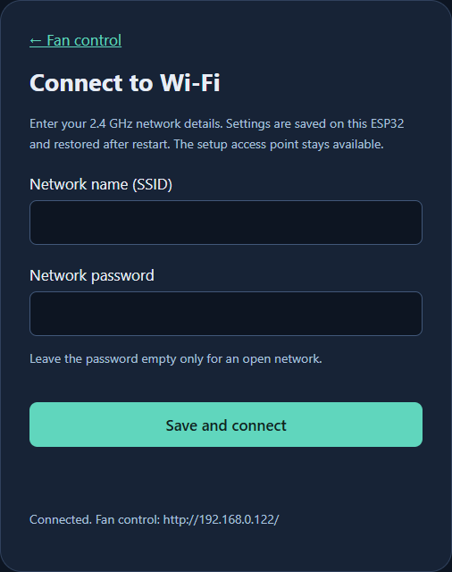

# ESP32 standalone Wi-Fi fan controller

Standalone firmware for an original ESP32 development board. The ESP32 drives a two-wire fan through a BD139 transistor and serves its own browser control page, with station Wi-Fi, a setup access point, and persistent network settings.

## Screenshots

Captured from the web server running on a physical ESP32. The graphs show its live internal chip-temperature reading and applied PWM duty.

### Desktop dashboard



### Editable curve and live operating point

The amber vertical line tracks current temperature, the horizontal guide shows applied fan duty, and their intersection marks the live operating point. A purple target marker appears when startup assistance temporarily differs from the requested speed.



<details>
<summary>Mobile dashboard and Wi-Fi setup</summary>

<p></p>



</details>

## PWM pin and wiring

**Set `FAN_PWM_PIN` in `include/fan_config.h`. The default is GPIO23**, usually marked `23`, `IO23`, or `D23` on an ESP32 development board. This is a GPIO number, not the 23rd physical connector pin. Rebuild and flash after changing it. Use an exposed output pin appropriate for your board; avoid flash GPIO6..11, input-only GPIO34..39, UART GPIO1/3, and boot strapping GPIO0/2/5/12/15. The supplied build targets the original ESP32, not C3/S2/S3 variants.

```text
ESP32 GPIO23 ---- 470 ohms ---- BD139 base (B)
                                  |
                               10 kohms
                                  |
ESP32 GND -------------------- BD139 emitter (E) ---- 12 V negative
fan negative ----------------- BD139 collector (C)
fan positive --------------------------------------- +12 V
```

Connect GPIO23 through the base resistor to the BD139. USB powers the ESP32; the fan uses its external supply. Join ESP32 GND and fan supply negative. Never connect 12 V to an ESP32 pin. Verify the transistor manufacturer's B/C/E pinout. Fit the flyback diode across the fan: cathode to +12 V, anode to collector/fan negative. The base-to-emitter resistor holds the transistor off during reset.

The existing 470 ohm base resistor provides roughly 5 mA from a 3.3 V GPIO. Check BD139 saturation and heating against the fan's running and starting currents; a suitable 3.3 V logic-level MOSFET may be needed for higher current.

## Behavior

- Hardware PWM at 100 Hz for the existing two-wire fan power-switching circuit.
- On restart or when starting from stopped: 100% for one second, then the requested duty. A stop command cancels the startup interval. Saved mode and settings are restored after restart.
- Manual duty: 20% through 100%. At 100%, the transistor remains continuously on. Automatic and curve modes can stop the fan at 0%. Adjust the duty limits and startup behavior in `include/fan_config.h`.
- Mode, manual duty, automatic parameters, curve points, and temperature offset are saved together in NVS flash. History stays in RAM.
- Wi-Fi connection/reconnection runs without waiting in the application loop; PWM continues independently of the network.
- No RPM feedback is connected. Duty is not a measured speed; verify the fan starts and stays turning at the chosen minimum.

## Wi-Fi and web control

`include/secrets.h` contains your initial local station Wi-Fi credentials and is ignored by Git. On the first boot, these settings are saved to ESP32 NVS flash. Later boots load the saved settings. A fresh checkout requires copying `include/secrets.example.h` to `include/secrets.h` and supplying initial credentials. Once settings have been saved, change them through the setup page; editing compiled defaults does not override saved NVS settings. Credentials are stored on the device and compiled into the initial firmware.

Use a 2.4 GHz Wi-Fi network. After boot, read the DHCP address from serial at 115200 baud and open `http://ADDRESS/`, or try `http://esp32-fan.local/` on devices with mDNS support. The page shows live chip temperature, applied duty, manual/automatic/curve controls, graphs, GPIO, and connection state. It is served from ESP32 flash; the PC can be disconnected after flashing when the ESP32 has another USB power supply.

The HTTP interface has no login and is intended for your trusted local network. Serial control remains available and station connection retries occur every 30 seconds.

### Setup access point and saved Wi-Fi settings

The ESP32 also runs a password-protected AP, including when station Wi-Fi is disconnected:

- Wi-Fi name: **ESP32-Fan-Setup**
- AP password: **FanSetup32!**
- Setup page: **http://192.168.4.1/wifi**
- Fan control over the AP: **http://192.168.4.1/**

Connect a phone or computer to this AP, stay connected if it reports no internet, and open the setup address. Enter the station SSID and password, then select **Save and connect**. The form clears the password after saving and never reads the stored password back. SSID and password are written together as one NVS record; the device then reconnects while keeping the setup AP available. Saved settings survive reboot and normal firmware uploads. Invalid input does not overwrite existing settings.

SSID must be 1..32 bytes. WPA passwords must be 8..63 bytes, or a 64-digit hexadecimal key; an empty password selects an open network. This original ESP32 supports 2.4 GHz Wi-Fi. AP and station share one radio/channel, so an AP client may briefly reconnect when the station changes channel. Change the AP name/password in `include/fan_config.h` and reflash if desired.

## Temperature, automatic control, and curves

The temperature is the original ESP32's experimental internal chip reading, obtained with Arduino `temperatureRead()`. It includes the chip's self-heating and does not measure calibrated air temperature. A finite, plausible but biased or stuck reading cannot be identified as faulty by this firmware. Choose thresholds for the chip reading in the intended enclosure; use an external sensor when actual air/surface temperature is required.

Samples are read every second and smoothed using an exponential filter with weight 0.25. The dashboard shows Celsius and device-side temperature/PWM history with **5, 10, 20, and 30 minute** views. The ESP32 stores 361 samples at five-second intervals, retaining 30 minutes even without a browser open. History resets when the ESP32 reboots; invalid readings produce gaps instead of invented temperatures. The graphs and editor work offline over the setup AP.

Choose a control mode from the dropdown:

- **Manual:** fixed saved duty, adjustable from 20% to 100%. The **Turn fan off** button below the speed control stops the output immediately, cancels startup assistance, and selects Manual mode from any mode. The off state is saved to flash and remains off after reboot. Apply a manual speed or select an automatic mode to restart.
- **Automatic:** start at 40 °C, stop at 35 °C, and ramp from 30% at 40 °C to 100% at 60 °C by default. Once running, the fan stays at least at its minimum until the stop threshold. Edit start/stop/full-speed temperatures and minimum/maximum duty, then save.
- **Curve:** add, edit, or remove 2–10 temperature/duty points and save. Temperatures must increase by at least 0.5 °C; duties must not decrease. The controller interpolates between points and holds the endpoint duty outside the curve. Use 0% to stop or 20–100% to run; interpolated running values below 20% are raised to 20%. Threshold-mode start/stop/min/max settings do not limit curve points. The same graph overlays an amber temperature line, an applied-duty guide, and a live operating-point marker. During startup a purple ring shows the target while the amber point shows actual applied duty. Unsaved point edits are labeled as a preview; live readings continue to reflect the running controller.

The automatic ON/OFF switch returns to Manual when OFF and resumes the last automatic strategy when ON. Manual web commands are rejected while either automatic strategy is active. A numeric serial command explicitly selects Manual and saves that duty.

The default curve is 35 °C / 0%, 40 °C / 30%, 50 °C / 65%, and 60 °C / 100%. Curve restart hysteresis defaults to 1 °C above the last 0% point and can be set from 0 to 10 °C. The temperature offset can be set from -20 to +20 °C and affects displayed/controlled temperature; it is a correction, not a room-temperature calibration.

Non-finite, implausible, or stale readings in Automatic/Curve mode request 100% duty, overriding configured curve/automatic maxima. First-time defaults use Manual at 50%; enabling automatic control is an explicit user setting. Existing saved Wi-Fi settings and earlier control settings are preserved on upgrade.

## HTTP API

- `GET /api/status`: JSON target/applied duty, configured limits, PWM pin/frequency, startup state, Wi-Fi state, station/AP IPs, and saved-settings state, chip temperature, and a `control` configuration object. Passwords are never returned.
- `GET /api/history?minutes=5`: choose 5, 10, 20, or 30. Returns uptime, sample interval, and chronological samples `[age_seconds, temperature_c_or_null, applied_percent]`.
- `POST /api/control`: partial form update using `auto_enabled` (0/1), `strategy` (`threshold`/`curve`), `stop_c`, `start_c`, `full_c`, `min_percent`, `max_percent`, `offset_c`, `curve_hysteresis_c`, and/or `curve` (e.g. `35:0,40:30,50:65,60:100`). Invalid or duplicate fields reject the entire update without modifying flash/runtime settings.
- `POST /api/wifi`, form body with `ssid` and `password`: validate and save station settings in flash, then reconnect. Returns HTTP 400 for invalid input or HTTP 503 if flash storage fails.
- `POST /api/fan/off`, no arguments: stop immediately, select Manual, and persist the off state. Works from Automatic and Curve modes too.
- `POST /api/fan`, form body `percent=50`: apply zero (off) or an integer within the configured running limits and return status. Invalid/missing/duplicate arguments return HTTP 400 without changing the setting. Automatic strategies return HTTP 409 for manual web commands.
- Serial: send `0` to stop and select Manual, or a duty such as `50` followed by Enter, or `?` for status and the web address. Invalid commands leave the target unchanged.

## Build and flash

Uses PlatformIO Core with pinned `espressif32@6.12.0` and its Arduino-ESP32 2.0.17 framework. This version uses the channel-based LEDC API. All libraries are included in the ESP32 framework.

```powershell
Copy-Item include\secrets.example.h include\secrets.h
# Edit include/secrets.h with your initial Wi-Fi credentials.
.\build.ps1
.\flash.ps1 -Port COM4 -SkipBuild
.\.venv\Scripts\pio.exe device monitor --port COM4 --baud 115200
```

Scripts use `.venv/Scripts/pio.exe`, falling back to `pio` in PATH. Install PlatformIO Core if needed: `python -m pip install platformio`. The first build downloads its pinned ESP32 tools. Firmware outputs are in `.pio/build/esp32dev/`. Uploads use 460800 baud. Close any serial monitor before uploading. If another port is assigned after reconnecting, pass that port to `flash.ps1`.

## Validation

Verified on an ESP32-D0WDQ6 with 4 MB flash:

- Build and USB upload at 460800 baud passed, including flash hash verification.
- Fan and Wi-Fi setup pages responded over the local network.
- Manual 100%, automatic cutoff/ramp/hysteresis, curve interpolation, add/remove/save, and invalid-input handling passed on the live device.
- All four history windows and desktop/mobile layouts passed browser checks without JavaScript errors.
- Reboot restored mode, curve points, thresholds, offset, manual duty, and Wi-Fi settings.
- The Turn fan off button stopped Curve mode, cancelled startup assistance, and remained off after reboot.
- The Wi-Fi setup endpoint saved credentials to NVS; a reboot loaded them and rejoined the network.
- The WPA2 setup AP was visible and accepted a PC connection.

Electrical PWM waveform, actual fan RPM, and transistor temperature have not been measured. The chip-temperature readout is not calibrated.

### Repeatable tests

```powershell
.\tests\run.ps1
.\.venv\Scripts\python.exe tests\test_device.py http://192.168.0.122
npm install --prefix .pio/ui-test --no-audit --no-fund playwright-core@1.64.1
node tests/test_dashboard.cjs http://192.168.0.122
# Refresh the README screenshots from a live board:
node tests/capture_screenshots.cjs http://192.168.0.122
```

The native tests download a Windows GCC runtime through PlatformIO and check thresholds, hysteresis, curve interpolation/validation, invalid-reading fallback, and 30-minute ring-buffer retention. Device/browser tests exercise real controls and restore the original settings afterward. Browser tests use an installed Chrome browser; generated dependencies and screenshots remain under ignored `.pio/`.

## References

- [Espressif Arduino Wi-Fi API](https://docs.espressif.com/projects/arduino-esp32/en/latest/api/wifi.html)
- [Pinned PlatformIO ESP32 platform](https://github.com/platformio/platform-espressif32/tree/v6.12.0)
- [Arduino-ESP32 2.0.17 LEDC header](https://github.com/espressif/arduino-esp32/blob/2.0.17/cores/esp32/esp32-hal-ledc.h)
